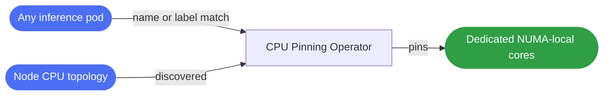

<!--
Copyright (C) 2026 Intel Corporation
SPDX-License-Identifier: Apache-2.0
-->

# CPU Pinning Operator

**Get more from the Intel® Xeon® servers you already own.** Each CPU-heavy workload you
choose gets its own dedicated share of the server.

* **More from existing hardware** - Higher utilisation and lower cost per request, without buying more servers.
* **Predictable performance** - Important workloads get dedicated cores, kept apart from other pods; host processes and interrupts are not isolated.
* **No application changes** - Install once, choose what to prioritise, see the result on a live dashboard.
* **Works where you already run** - Kubernetes and Red Hat® OpenShift® (tested on 4.22.4).

`cpu-pinning-operator` discovers node topology, creates per-node balloon policies for
the NRI (Node Resource Interface) balloons plugin, and annotates matched pods so the
plugin pins them to physical cores.



You don't edit the workload: admission adds an annotation, an init container and node
affinity to the Pod. No other pod is placed on the pinned CPUs, and in the default mode
their hyperthread siblings stay out of the pool; host processes and interrupts are not
isolated. The reconcilers, webhook and NRI handoff are in
[architecture.md](docs/architecture.md).

## Why use it?

* **No workload rewrite** - Match a container name or pod labels; the webhook adds the balloon annotation.
* **Whole-core isolation** - Default physical-core mode removes hyperthread siblings from the workload pool.
* **NUMA-aware placement** - Balloon spans follow CPU requests and node topology.
* **Pinned or rejected** - `enforcePinning` denies a matched pod when pinning cannot complete.
* **Ready to operate** - Metrics, Grafana dashboards, TLS, NetworkPolicy, and drift detection ship with the chart.

---

## How it works

`BalloonsClusterConfig` sets cluster-wide CPU and security defaults;
`BalloonPinningPolicy` selects the namespaces and workloads to pin. An injected
init container holds a matched pod until the balloons plugin is Ready on its node.

`NodeResourceTopology` (NRT) reports the cpuset the plugin actually assigned. Terms such
as balloon and span are defined in the [glossary](docs/observability.md#glossary).

---

## Quickstart

**Requires:** Kubernetes 1.29+, a container runtime with NRI enabled, Helm, and
cert-manager — the [compatibility table](docs/upgrade.md#compatibility) gives the
versions and marks which are tested. containerd 2.x enables NRI by default; if your
config turns it off, set `disable = false` under `[plugins."io.containerd.nri.v1.nri"]`
and restart containerd ([NRI docs](https://github.com/containerd/nri)). Without NRI the
plugin pod never becomes Ready and matched pods wait in `Init`. The image is built for
linux/amd64 only. The chart installs the balloons plugin by default. The kubelet on every
pinning node must run CPU Manager policy `none`; the `static` policy allocates the same
CPUs as the plugin. Check each node:

```bash
kubectl get --raw /api/v1/nodes/<node>/proxy/configz | jq -r .kubeletconfig.cpuManagerPolicy
# → none
```

No chart repository is published; install from a checkout of the release tag:

```bash
git clone https://github.com/intel/cpu-pinning-operator
cd cpu-pinning-operator
git checkout v1.0.0

helm repo add jetstack https://charts.jetstack.io
helm repo update
helm install cert-manager jetstack/cert-manager --version v1.20.3 \
  -n cert-manager --create-namespace --set crds.enabled=true --wait

helm install cpu-pinning-operator ./deploy/cpu-pinning-operator \
  -n cpu-pinning-operator-system --create-namespace \
  --set 'balloonPinningPolicy.match.byContainerName={vllm}' \
  --set 'balloonPinningPolicy.namespaces={inference}'
```

The chart has no default target: name the pods to pin and the namespaces to watch, or
the install fails. This pins container `vllm` in namespace `inference` and reads the span
(how many NUMA nodes the pinned CPUs cover) off vLLM's `--tensor-parallel-size`. For a
KServe predictor use `-f docs/examples/values/kserve.yaml`; change the name, add a glob,
or match on pod labels to pin anything else.

Wait until the webhook is serving and at least one node is provisioned. A pod created
earlier is admitted without pinning (the webhook only mutates at `CREATE`) or denied by
`enforcePinning`:

```bash
kubectl -n cpu-pinning-operator-system rollout status deploy/cpu-pinning-operator
kubectl wait bcc/cluster --for=condition=Ready --timeout=10m   # reason NodesProvisioned
```

Then try it with a pod whose CPU requests equal its limits, in whole cores:

```bash
kubectl create namespace inference
kubectl apply -f - <<'YAML'
apiVersion: v1
kind: Pod
metadata:
  name: vllm-demo
  namespace: inference
spec:
  containers:
    - name: vllm
      image: registry.k8s.io/pause:3.9
      args: ["--tensor-parallel-size", "1"]
      resources:
        requests: {cpu: "4", memory: 256Mi}
        limits: {cpu: "4", memory: 256Mi}
YAML
kubectl -n inference get pod vllm-demo -o jsonpath='{.metadata.annotations}'
# → includes "balloon.balloons.resource-policy.nri.io/container.vllm":"balloon-span1"
```

Then check the assignment on the node:

```bash
kubectl -n cpu-pinning-operator-system logs ds/nri-resource-policy-balloons | grep assigning
kubectl get noderesourcetopology <node> -o yaml
```

> [!NOTE]
> The bundled plugin runs in the release namespace. Use `-n kube-system` only when
> the plugin was installed separately.

### Use it with an AI coding agent

The repo ships an agent skill, [`use-cpu-pinning-operator`](skills/use-cpu-pinning-operator/SKILL.md).
It takes an agent from "nothing installed" to "this pod runs on its own cores": it checks
prerequisites, installs with Helm, picks pods with a `BalloonPinningPolicy`, verifies pinning
and troubleshoots. For Claude Code, copy the folder into `.claude/skills/` (or
`~/.claude/skills/`) and ask, for example, "Why is my pod not pinned?".

---

## Next steps

| Task | Guide |
|---|---|
| Select workloads and tune CPU placement | [Configuration](docs/configuration.md) |
| Understand components and reconciliation | [Architecture](docs/architecture.md) |
| Upgrade or roll back a release | [Upgrade](docs/upgrade.md) |
| Diagnose admission, placement, or plugin failures | [Troubleshooting](docs/troubleshooting.md) |
| Configure metrics and dashboards | [Observability](docs/observability.md) |
| Harden a production deployment | [Secure configuration](docs/secure-configuration.md) |
| Review the trust boundaries and accepted risk | [Threat model](docs/threat-model.md) |
| Report a bug or contribute a change | [Contributing](CONTRIBUTING.md) |
| Build and test the operator | [Contributor docs](docs/internal/) |
| Review all docs | [Documentation index](docs/README.md) |

Chart values are listed in the [chart README](deploy/cpu-pinning-operator/README.md).
Report vulnerabilities through [SECURITY.md](SECURITY.md), never a public issue.

## License

Apache-2.0. Copyright (C) 2026 Intel Corporation.

Intel, the Intel logo, Xeon and other Intel marks are trademarks of Intel Corporation or its
subsidiaries. *Other names and brands may be claimed as the property of others.
