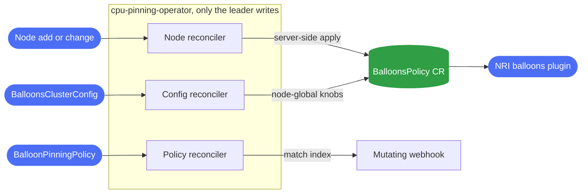
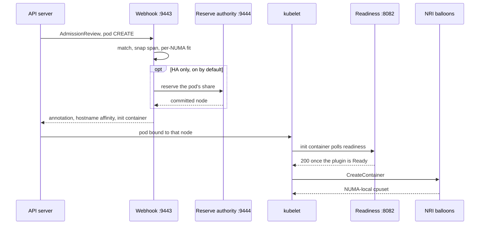

<!--
Copyright (C) 2026 Intel Corporation
SPDX-License-Identifier: Apache-2.0
-->

# Architecture

The operator reads each node's NUMA topology, generates balloon types from it,
provisions a per-node `BalloonsPolicy` CR, and stamps matched pods with a
balloon-selection annotation so the NRI (Node Resource Interface) balloons plugin pins
them to NUMA-local physical cores.

## Provisioning

Three triggers, three reconcilers. Node and config changes converge on the
per-node CR that NRI acts on; policy changes only feed the webhook's match index.

| Reconciler | Trigger | Writes |
|---|---|---|
| Node | Node add or change | Runs an unprivileged probe pod reading `/sys` and `/proc/cpuinfo`, applies `BalloonsPolicy/node.<name>`, labels the node, emits Node Events. Caches each reading by boot id, so a config flip re-renders without re-probing. Concurrency defaults to 5 (`NODE_RECONCILE_CONCURRENCY`) |
| BalloonsClusterConfig | `cluster` singleton | Publishes `cpuAllocation`, the reserved pool and `excludeNodeSelector`; drives webhook `failurePolicy`. Owns the per-node CRs, so `helm uninstall` reaps them through garbage collection |
| BalloonPinningPolicy | Per-workload policies | Builds the match index, drives the webhook `namespaceSelector`, publishes `status.boundPods` |
| Pod drift | Pinned pods | Emits `Drifted` or evicts to re-pin, rate-limited and PDB-aware |
| Readiness CA | Webhook `namespaceSelector`, Namespaces, every minute | Copies `ca.crt` into `<fullname>-readiness-ca` in each targeted namespace for the init container to verify the HTTPS readiness endpoint; owned by the singleton |
| NRT metrics | `NodeResourceTopology` | Rebuilds the per-CPU assignment metric — see [observability.md](observability.md) |

A validating webhook guards `BalloonPinningPolicy` DELETE and narrowing UPDATE
when a policy sets `spec.guardActivePods`.

## Admission

The reserve hop is HA-only and on by default; a single replica commits in-process.
The injected `wait-for-balloons` init container holds the workload until the plugin
is Ready on its node, so nothing starts unpinned.

Where the webhook must abort a matched pod — no provisioned node, an unreadable
Node, topology or capacity — the policy decides: `enforcePinning: true` (default)
denies with a sanitized message, `false` admits unpinned and records a bypass. A
request it cannot decode is admitted unmutated: no pod, so no policy applies.

## Balloon sizing

- Balloon size comes from the pod's CPU request. Requests are never rewritten.
- Span is `snap(span × multiplier)` rounded up to `{1,2,4,8}`, capped by the
  target node's `…/max-span`, or by the cluster-wide max at pre-schedule
  admission.
- `cpuAllocation: physical-cores` (default) removes every hyperthread sibling
  from the allocatable pool, so N requested CPUs consume N whole physical cores.
  See [`cpuAllocation`](configuration.md#cpuallocation-physical-cores-vs-hyperthreads).
- **Device pods bypass span derivation entirely.** Any container requesting an
  extended resource is routed to `balloon-device`, which carries
  `preferCloseToDevices: ["podresourceapi:*/*"]` and pins to CPUs on the granted
  device's NUMA node, ignoring parallelism hints. The glob matches any vendor, so a
  new accelerator needs no Go change. Per-container resolution needs the kubelet
  `KubeletPodResourcesGet` gate, alpha and off by default; without it the routing
  holds but the device-to-NUMA steering no-ops. The plugin ships a `List()`
  fallback meant to cover exactly that case, but in v0.15.2 the fallback never
  runs — it is selected by matching the kubelet's error text against
  `"pod resource API Get method disabled"`, and the kubelet says
  `"PodResources API Get method disabled"`
  ([nri-plugins#801](https://github.com/containers/nri-plugins/issues/801)). See the
  [`KubeletPodResourcesGet` gate](observability.md#the-kubeletpodresourcesget-gate-stays-off)
  and [BalloonPinningPolicy fields](configuration.md#balloonpinningpolicy-fields).
- **Intel® Priority Core Turbo (Intel® PCT) power priority.** The policy defines two CPU classes,
  `gpu-hp` (`pctPriority: high`) and `cpu-lp` (`pctPriority: low`); `balloon-device`
  uses `gpu-hp` so any device/accelerator workload runs on high-priority cores, while
  every CPU-only leaf (`pkg
node<N>`) uses `cpu-lp`. Composites (node-set and span)
  carry no class — the plugin rejects a policy that sets one — and take `cpu-lp` from
  their leaf components. The reserved pool is left neutral. nri-plugins maps these classes to Intel® Speed
  Select Technology – Core Power (Intel® SST-CP) classes of service (CLOS). The operator
  always renders them; whether they take effect depends on the hardware, the BIOS
  setting and the plugin's own privilege setting (`nri-resource-policy-balloons.allowPCT`,
  off in the bundled subchart).

## Readiness gating

`:8081/readyz` reflects whether the webhook can actually mutate a pod, not merely
that the process is up. Checks: `informer-cache-sync`, `node-cache-sync`,
`webhook-cert`, `webhook-serving`, plus `reserve-cache-sync` where the authority
renders. Liveness is a bare ping. This narrows the window in which
`failurePolicy: Ignore` admits a pod unmutated.

## HA

The chart runs two replicas behind a `PodDisruptionBudget`. Every replica serves
admission; leader election keeps one writer. Two replicas would otherwise reserve against two
independent stores, so `webhook.reserveAuthority.enabled` defaults on above one
replica: the commit goes to the lease holder, and the fleet accounts against one
store.

The trade is availability: under `capacityCheck.mode: enforce` a commit the
authority cannot take denies the pod. A refused pod is retried by its own
controller; an over-admitted one stops in `CreateContainerError` and needs a human.
`warn` (the mode default) and `off` keep the per-replica fallback, bounded by the
reservation TTL and healed by `NodeResourceTopology`. Idempotency key, failover
warm-up:
[capacity-check-internals.md](internal/capacity-check-internals.md#leader-authoritative-reserve-ha-single-store).

The admission path reads Nodes through a dedicated label-scoped cache, so a
full-fleet scan stays proportional to the balloons-enabled subset.

Component deep-dives live in the code comments, which are the source: that cache's
separation from the manager's shared one at `newScopedNodeCache` and
`unleaderedCache`, the boot-id-tagged topology cache in `cachedTopology`
(`internal/controller/node_controller.go`), the match index in
`internal/match/index.go`, the per-NUMA share formula and live-occupancy
reconstruction in `internal/webhook/capacity.go`, the reservation store in
`internal/webhook/reservation.go`, the readiness cache-sync rationale above
`AddReadyzCheck("informer-cache-sync", …)` and the release-derived lease name at
`defaultLeaderElectionID` (all four in `cmd/main.go`).

See [configuration.md](configuration.md) to drive any of this, and
[development.md](internal/development.md) for the repository layout.
