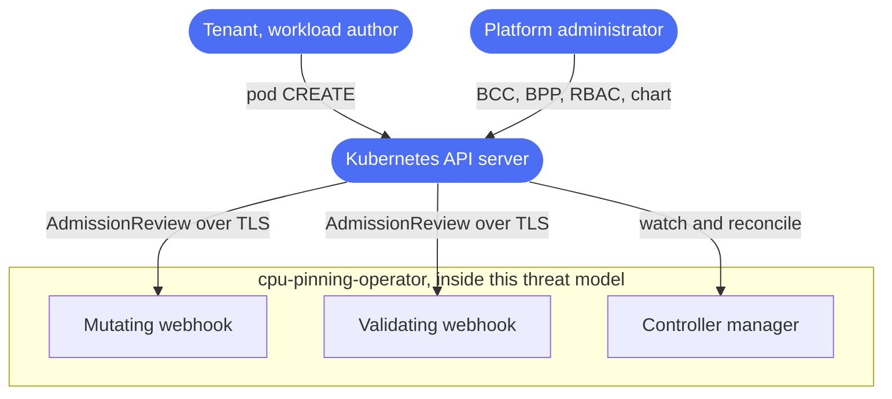
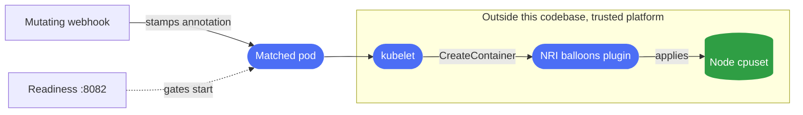

<!--
Copyright (C) 2026 Intel Corporation
SPDX-License-Identifier: Apache-2.0
-->

# Threat model

This document maps the operator's attack surface: assets worth protecting, trust
boundaries requests cross, threats STRIDE-style, and the mitigations. Known
gaps are named as current risks rather than papered over. Mitigations reduce, but do
not eliminate, risk. No product or component can be absolutely secure.

The architecture: a controller-manager serving a mutating webhook (9443) and a
validating webhook for policy guards, a per-node topology probe pod, node
classification from probe-detected AMX support and device resources (Node Feature
Discovery labels are only a fallback), and an injected
`wait-for-balloons` init container polling the readiness endpoint (8082). With
leader-authoritative reserve enabled it also serves an internal mTLS reservation
endpoint (9444). See [architecture.md](architecture.md) and
[Data handling](secure-configuration.md#data-handling).

## Assets

| Asset | Why it matters |
|-------|----------------|
| **Cluster-wide pinning configuration** (`BalloonsClusterConfig` singleton, `BalloonPinningPolicy` objects) | Both CRDs are **cluster-scoped**; editing either changes CPU placement for every tenant on the fleet. |
| **The mutating webhook decision path** | It rewrites pod specs at admission (annotation, init container, node affinity). A compromised or spoofed webhook can steer or stall any matched pod. |
| **The operator ServiceAccount and its RBAC** | It holds cluster-scoped verbs including `nodes/patch`, `pods/eviction`, and `patch` on its own `MutatingWebhookConfiguration` (pinned by `resourceNames`), plus `pods` create/delete in the release namespace only (for the topology-probe pods) — a high-value identity. The ClusterRole grants no `serviceaccounts:create` and no `clusterrolebindings` verbs (`deploy/cpu-pinning-operator/templates/rbac.yaml`), so admission cannot create cluster RBAC. |
| **Node topology data** | Read from each node's `/sys` and `/proc/cpuinfo` and published as node labels (`cpu-pinning-operator.intel.com/balloons-enabled`, `.../max-span`, `.../numa-nodes`, `.../physical-cpus`, `.../threads-per-core`, `.../memory-per-numa-bytes`, `.../package-topology`, `.../amx`, `.../node-class`, `.../reserved-cpus`, `.../cpu-allocation`, `.../cpu-manager-conflict`); it describes hardware layout but contains no secrets or PII. The operator also reads Node Feature Discovery labels (e.g. `feature.node.kubernetes.io/pci-10de.present`, `.../cpu-cpuid.AMX_*`) and allocatable device resources (`nvidia.com/gpu`, `gpu.intel.com/xe`) for automatic hardware-driven node classification (`internal/classification/classify.go`). |
| **The `BalloonsPolicy` per-node CRs** | The operator writes these into the balloons plugin's namespace (kube-system for external installs; the release namespace for self-install) via Server-Side Apply (field manager `cpu-pinning-operator`), allowing safe co-ownership with other controllers. NRI acts on them to pin cpusets. Tampering changes what physical cores a workload lands on. |
| **The webhook serving certificate** | A leaked key would let an attacker impersonate the webhook to the API server. |

## Trust boundaries

Who may write what, and where the API server sits between them:

Where the operator's authority ends and a trusted platform component takes over —
this boundary is current risk 1:

The boundaries an attacker would target:

1. **Tenant workload → mutating webhook.** Every pod CREATE in a targeted
   namespace is attacker-influenced input: container names, labels, requests,
   existing affinity and ServiceAccount.
2. **API server → webhooks.** AdmissionReview calls must be authenticated and
   encrypted, and the webhooks must be the only things answering for the Service.
   The API server calls 443, forwarded to the manager's 9443.
3. **Platform admin → pinning CRDs.** Whoever writes either CRD controls
   fleet-wide placement; whoever DELETEs or narrows a `BalloonPinningPolicy` can
   orphan pinned pods, guarded under `spec.guardActivePods`.
4. **Operator → nodes.** A probe pod on every node reads sysfs and procfs and
   publishes topology as node labels. It runs the operator's own image, so the
   content executed on a managed node is the same scanned artifact as the manager
   and no third-party image is pulled per node.
5. **NRI plugin → cpuset enforcement.** The operator stamps the annotation, the
   plugin enforces it. A failing plugin can silently bypass pinning while the
   control plane looks intact. **Current risk 1.**
6. **Kubelet CPU Manager coexistence.** Under `--cpu-manager-policy=static` both
   claim authority over the same cpusets. The operator reads the cluster's kubelet
   configuration from kubeadm's ConfigMap and flags the nodes, but it neither
   inspects each kubelet directly nor arbitrates the two allocators. **Current
   risk 2.**

## The balloons-readiness gate

The injected `wait-for-balloons` init container gates a workload's start on the
plugin being Ready on its node. It does **not** talk to the API server: it runs the
operator's own image and polls `GET /balloons/ready?node=<name>`, so it needs no
ServiceAccount token, no `kubectl` and no RBAC. The manager answers from its
existing read-only `pods` and `daemonsets` grants.

The webhook creates **no cluster RBAC** at admission, and the ClusterRole grants
neither `serviceaccounts: create` nor any `clusterrolebindings` verb, so admission
holds no privilege-escalation primitive. The endpoint asks no
client credentials (the poller sends none) and exposes only a per-node boolean;
`networkPolicy.enabled` scopes who can reach it. It serves HTTPS, and the init
container verifies the `balloons-ready` Service name against `ca.crt`, which the
operator copies into a `<fullname>-readiness-ca` ConfigMap in each namespace the
webhook targets. So a spoofed "ready" cannot start a workload before its pinning.

A tenant who can write ConfigMaps in their namespace can replace that copy. That
only misleads the init containers of pods in the same namespace, which already run
with that tenant's privileges, and the operator overwrites the copy within a minute.
Other namespaces mount only their own copy. A pod admitted before its copy exists
waits in `Init`; it never falls back to plaintext.

## Threats and mitigations (STRIDE)

| Threat | Mitigation | Status |
|---|---|---|
| **S** Impersonating the webhook | TLS with a cert-manager-issued, rotated cert; both webhook configurations pin the CA via `cert-manager.io/inject-ca-from`; `webhook-cert` and `webhook-serving` keep a replica out of rotation until it can complete a handshake | Mitigated |
| **S** Posting a forged `AdmissionReview` straight at the webhook, bypassing the API server (a burst of them consumes the in-memory reservation ledger and denies or mis-steers real pods) | The webhook requires no client certificate, so the network path is the whole control: `networkPolicy.webhook.from` pins ingress on `:9443` to the addresses the API server dials from. Empty by default, because a host-networked API server is matchable only by `ipBlock` and those addresses are site-specific | Partial, the mitigation is opt-in and needs a NetworkPolicy-enforcing CNI |
| **S** Spoofing the readiness verdict so a workload starts before its pinning | HTTPS on 8082; the init container verifies the cert against the namespace's CA copy and the `balloons-ready` Service name, with no plaintext or skip-verify fallback. `balloonsReady.secure: false` is an explicit opt-out | Mitigated |
| **T** Replacing the readiness CA copy in a namespace | Affects only that namespace's init containers (see [the readiness gate](#the-balloons-readiness-gate)); the operator rewrites the copy every minute | Accepted, bounded to the writer's namespace |
| **S** Impersonating the operator identity | Dedicated ServiceAccount bound to one ClusterRole and one release-namespace Role; no shared or cluster-admin credentials | Mitigated |
| **T** Editing pinning config to move a fleet | RBAC keeps these verbs off tenant roles; a CEL rule enforces the `cluster` singleton. Neither restricts *who* writes — see the opt-in policies in [admission-policies.md](admission-policies.md) | Partial, defence in depth is opt-in |
| **T** Tampering with per-node `BalloonsPolicy` CRs | They live in the plugin's namespace, owned by the operator; cluster RBAC governs writes, and the node reconciler rewrites the CR from the cluster config on its next pass for that node (a node or `BalloonsClusterConfig` change, or the 10-minute resync) | Mitigated |
| **T** Crafting inputs to steer a pod to a chosen node | The webhook is a read-only preflight that never inflates a footprint — `span` scales the capacity side, never the request. Gate and placement filter share one predicate, and a commit naming a node the replica did not offer is treated as a failed RPC | Mitigated |
| **R** No audit trail | Node Events (`Provisioned`, `BalloonsPolicyUpdated`, `Deprovisioned`, `ProvisioningFailed`), webhook Events for skips, preflight failures and bypasses, `status.boundPods`; everything flows through the API server, so audit logging applies | Mitigated |
| **I** Reading more than it needs | The probe reads only world-readable `/sys/devices/system/*` and `/proc/cpuinfo`; the webhook reads pod specs and `NodeResourceTopology`. The manager additionally reads kubeadm's `kube-system/kubelet-config` ConfigMap for the cluster's CPU Manager policy (see current risk 2) — cluster configuration, not workload data, and through the `configmaps` verbs it already holds, so it reaches no kubelet. It reads no workload Secrets; its only credentials are its own ServiceAccount token and serving key. Object metadata it reads can hold whatever users put there (see [Data handling](secure-configuration.md#data-handling)). Topology becomes node labels, already broadly readable | Mitigated |
| **I** Leaking the webhook serving key | cert-manager Secret in the operator namespace, mounted read-only, with `readOnlyRootFilesystem` | Mitigated |
| **D** Webhook on the pod-CREATE hot path | `namespaceSelector`-scoped, `sideEffects: None`, bounded `timeoutSeconds`, two replicas behind a PDB with a readiness gate reflecting real mutate-ability. `failurePolicy: Ignore` trades the guarantee for availability; aborts it answers follow `enforcePinning`, denying with a `PinningDenied` Event or admitting while recording `cpu_pinning_webhook_bypasses_total`. Neither is silent | Mitigated, the availability trade is a choice |
| **D** Eviction storm on a fleet-wide change | Token bucket on the leader, default one eviction per 10s with burst 2, PDB-aware: a blocked eviction backs off, never force-deletes | Mitigated |
| **D** Burst admitting more pods than a node holds | Fit re-check and reservation commit are atomic in the authoritative store, and the pod is required onto the node that commit returned | Mitigated |
| **D** Forged AdmissionReviews filling the in-memory reservation ledger | A reservation expires one `--reservation-ttl` (90s default) after the admission that took it, so booking phantom headroom for pods that never exist costs at most one TTL of capacity denials on the node, never a permanent one. The answer goes to the caller and creates no Pod, though it is not free of side effects: each verdict records an Event against the pod decoded from the forged body, with no existence check, so a burst does leave Events naming pods that never existed. Namespace scoping bounds both that trace and the mutation — the pod's namespace is re-checked at request time from the decoded object rather than the caller's claim, and only a matched pod reaches a verdict at all, so a forger reaches no namespace a policy does not already target. All three are exercised against a live cluster by an e2e test ([e2e-internals.md](internal/e2e-internals.md)) that mounts the burst and asserts the ledger drains itself | Mitigated for the ledger; who may reach 9443 at all is a `NetworkPolicy` question — see [Network exposure](#network-exposure) |
| **D** Stranding a pod on its reserved node | The candidate scan skips nodes with an untolerated `NoSchedule`/`NoExecute` taint (cordoned and `NotReady` among them), nodes whose `allocatable` misses a requested extended resource, nodes the pod's own selector or required affinity rejects, and nodes missing a `require`-mode `nodeFeatures` label. Blast radius is one pod; recovery is delete and recreate, which re-scans | Partial, the admission-to-binding window cannot be closed at admission time |
| **E** Admission-time cluster RBAC creation | Not applicable: the webhook creates no ClusterRoleBindings or ServiceAccounts and the ClusterRole grants neither verb — see [the readiness gate](#the-balloons-readiness-gate) | By design |
| **E** Probe pod as a node foothold | Runs unprivileged: `runAsNonRoot` (uid 1000), no privilege escalation, all capabilities dropped, `RuntimeDefault` seccomp, no `hostPID`/`hostNetwork`/`hostPath`. Satisfies the restricted Pod Security Standard. On OpenShift its fixed uid needs the probe SCC that `openShift.enabled=true` renders; `restricted-v2` alone rejects it. The init container satisfies both with no exemption, as a non-root uid | Mitigated |
| **E** Manager container as an escape target | `readOnlyRootFilesystem`, `runAsNonRoot`, no privilege escalation, all capabilities dropped, `RuntimeDefault` seccomp | Mitigated |

## Network exposure

The manager serves up to five listener ports (`cmd/main.go`), four by default plus
one HA-only port:

| Port | Purpose | Transport | Listener |
|------|---------|-----------|----------|
| **9443** | Admission webhooks (mutating + validating) | HTTPS (cert-manager serving cert, CA-injected into `MutatingWebhookConfiguration` and `ValidatingWebhookConfiguration`) | `controller-runtime` webhook server |
| **8080** | Prometheus metrics (`/metrics`) | HTTPS by default (`--metrics-secure`, cert-manager serving cert; set false to fall back to plaintext HTTP) **and authenticated by default** (`--metrics-require-auth`): the client's bearer token is resolved by `TokenReview` and authorized for `get /metrics` by `SubjectAccessReview`, so an anonymous request gets `401` and an unauthorized one `403` | `controller-runtime` metrics server (`metricsServerOptions`, `filters.WithAuthenticationAndAuthorization`) |
| **8081** | Health probe (`/healthz`, `/readyz`) | HTTP (unauthenticated) | `controller-runtime` health probe |
| **8082** | Per-node balloons-readiness endpoint (`/balloons/ready?node=<name>`) | HTTPS, TLS 1.3 only, by default (`--balloons-ready-secure`, cert-manager serving cert; set false to fall back to plaintext HTTP), no client auth, rate-limited per source IP: 2 req/s burst 5, returns HTTP 429 when exceeded; returns a small JSON object: `{"node":"<name>","ready":bool,"reason":"...","error":"..."}` where `error` is present only on handler-internal API failures | `internal/readiness` (`readiness.Handler` in `readiness.go`, polled by the injected `wait-for-balloons` init container) |
| **9444** | Leader-authoritative reserve endpoint (HA only, `--reserve-authority`) | HTTPS (internal mTLS, TLS 1.3 only, same cert-manager serving cert re-read on every handshake; peer verified against the serving-cert DNS SAN, not just the CA chain, so a same-Issuer cert with a different SAN cannot impersonate a replica) | `internal/webhook.ReserveAuthority` (followers forward reserve requests to the lease holder) |

A default-deny `NetworkPolicy` (`networkPolicy.enabled`, on by default) shrinks the
blast radius to these ingress ports plus the egress it needs (API-server ports and
DNS). Tune `networkPolicy.egress.apiServerPorts` for your cluster. See the
[chart README](../deploy/cpu-pinning-operator/README.md).

All four default ingress ports are open to **any** source out of the box. For 9443,
8081 and 8082 that is structural: their callers are host-networked (API server,
kubelet) or live in arbitrary target namespaces (the injected init container), and no
pod or namespace selector can match them. 8080 is open only because the chart ships no
default peer list.

Two of them narrow from values. `networkPolicy.webhook.from` pins 9443 to the addresses
the API server dials from — see
[secure-configuration.md](secure-configuration.md#restricting-the-webhook-port), which
covers finding them and the tunnelled-control-plane case where the peer is a
`podSelector` rather than an `ipBlock`. `networkPolicy.metrics.from` pins 8080 to your
scrapers, usually a `namespaceSelector`+`podSelector` for the monitoring stack. 8081 and
8082 cannot be narrowed; 8082 is rate-limited per source IP instead and returns one
per-node boolean.

## Current risks

Known gaps where a threat exists without a full mitigation:

1. **NRI plugin enforcement.** The control plane is in scope here, but the cpuset
   enforcement happens in the `nri-resource-policy-balloons` DaemonSet, a separate
   component. The operator stamps the annotation and the readiness gate prevents
   starting a workload before the plugin is Ready. The drift reconciler then checks
   each running matched container against `NodeResourceTopology` (NRT), which the plugin
   publishes: a container not in a dedicated balloon 30 s after it started gets a
   `Drifted` Warning. That check trusts what the plugin reports and is skipped while NRT
   is missing or empty, so a compromised or buggy plugin can mis-apply pinning without a
   signal. The operator never reads the kernel cpusets itself.

2. **Kubelet CPU Manager coexistence.** With `--cpu-manager-policy=static` the
   kubelet and the plugin both manage cpuset affinity, so the kubelet can allocate
   CPUs reserved for balloons and the plugin can pin to CPUs the kubelet already
   assigned. The result is unpredictable placement, and running both on one node
   stays unsupported. *Mitigation:* the operator **detects and surfaces** it —
   it reads `cpuManagerPolicy` from kubeadm's `kube-system/kubelet-config` ConfigMap
   (through the `configmaps: get` it already holds for the dashboards, so the check
   costs no permission and reaches no kubelet) and, on `static`, emits a
   `CPUManagerConflict` Warning on each Node, sets
   `cpu_pinning_cpu_manager_conflict{node}` to 1, labels the node
   `cpu-pinning-operator.intel.com/cpu-manager-conflict=true` and reports
   `CPUManagerCompatible=False` on the `BalloonsClusterConfig`. Only an exact
   `static` or `none` is a verdict — with one documented default: `cpuManagerPolicy`
   is an **optional** field whose KubeletConfiguration default is `none`, and kubeadm
   writes it only where an administrator set it, so a document that declares
   `kind: KubeletConfiguration` and omits the key reads as `none`. That is the policy
   such a kubelet runs, and it is what makes the compatible verdict reachable on a
   stock cluster. A configuration that cannot be read — no such ConfigMap, as on a
   cluster kubeadm did not provision; no `kubelet` key; YAML that does not parse; a
   `cpuManagerPolicy` that is not a string; an omitted one in a document that does not
   declare that kind — or that names some other policy is **unknown**, not
   compatible: the node carries no conflict label at all, exports
   no series, and the condition reports `Unknown`/`PolicyUnread` rather than `True`.
   So this fails open without passing a guess off as a clean reading. *Still open:* the reading is **cluster-wide**, so the verdict describes the
   cluster's kubelet configuration and not each node's running kubelet; a kubelet
   reconfigured by hand — including one given `--cpu-manager-policy=static` on its
   command line while the ConfigMap says or defaults to `none`, which reports
   `compatible` — or a cluster not provisioned by kubeadm,
   is **not detected**. And the operator does not **arbitrate**: a flagged node is still
   provisioned and still pinned to, because withdrawing its policy would not take
   back the cpusets the kubelet has already assigned; fixing it is the
   administrator's action (change the policy, or exclude the node). The kubelet's
   `--reserved-cpus` and `BalloonsClusterConfig.spec.reserved` remain independent
   with no cross-validation. Reading each node's kubelet directly would close the per-node gap but
   needs `nodes/proxy`, which admits the kubelet's whole read surface — deliberately
   not granted.

3. **An unauthenticated webhook port.** `:9443` verifies the *server* but never the
   *caller*: `webhookServerOptions()` sets no `ClientCAs` and no `ClientAuth`, so a pod
   the network lets through is indistinguishable from the API server. (The
   reserve-authority port, 9444, is mutually authenticated: a peer must present a
   certificate from the operator's CA that carries the serving certificate's first DNS
   name, which the chart sets to the webhook Service.)
   `networkPolicy.webhook.from` closes the network path, but it is opt-in (no default is
   knowable), it needs a CNI that enforces NetworkPolicy, and on a tunnelled control
   plane the caller is a pod whose identity is only as good as that pod's. Requiring an
   apiserver **client certificate** would authenticate it independently of the network
   and is deliberately **not** implemented: it needs an `AdmissionConfiguration`
   kubeconfig placed on every control-plane node — out of reach of a chart, impossible
   on a managed control plane, and a rotation nothing here can automate, where a stale
   cert fails admission cluster-wide and, under `failurePolicy: Ignore`, silently. It
   would add coverage only on clusters whose API-server config the operator can edit,
   which is exactly where the `ipBlock` mitigation is easiest to apply.

4. **Removing the NRI plugin while pinned pods run.** Containers already running
   keep the cpusets they were given, but nothing pins a container that starts on that
   node while the plugin is gone. The readiness gate holds a new pod in `Init` while
   the operator sees no Ready plugin on its node, and a container restart can stall on
   a runtime that needs the plugin. A pod that does reach `Running` in that window
   carries the operator's pinned annotation and hash yet runs on the shared CPUs. The
   drift check (risk 1) relies on the NRT the plugin publishes, which nothing updates
   while the plugin is gone, so that loss of pinning can go without a `Drifted` event.
   Recovery: reinstall the plugin, then delete the affected pods so they are
   re-admitted; see [Troubleshooting](troubleshooting.md#the-nri-plugin-was-removed-while-pods-were-pinned).

## Assumptions and out-of-scope

- The API server, its admission chain and etcd are trusted; this model does not
  defend against a compromised control plane.
- The container runtime, the NRI balloons DaemonSet and cert-manager are trusted
  platform components. Vulnerabilities in them are out of scope unless exploitable
  through this operator — see [SECURITY.md](../SECURITY.md). The operator owns the
  policy, the plugin owns applying it. See current risk 1.
- Base-image and dependency CVEs are managed through image updates; licenses are
  in [third-party-licenses.md](third-party-licenses.md).
- A `cluster-admin` is already fully privileged; this model concerns
  lower-privileged tenants and the operator's own footprint.
